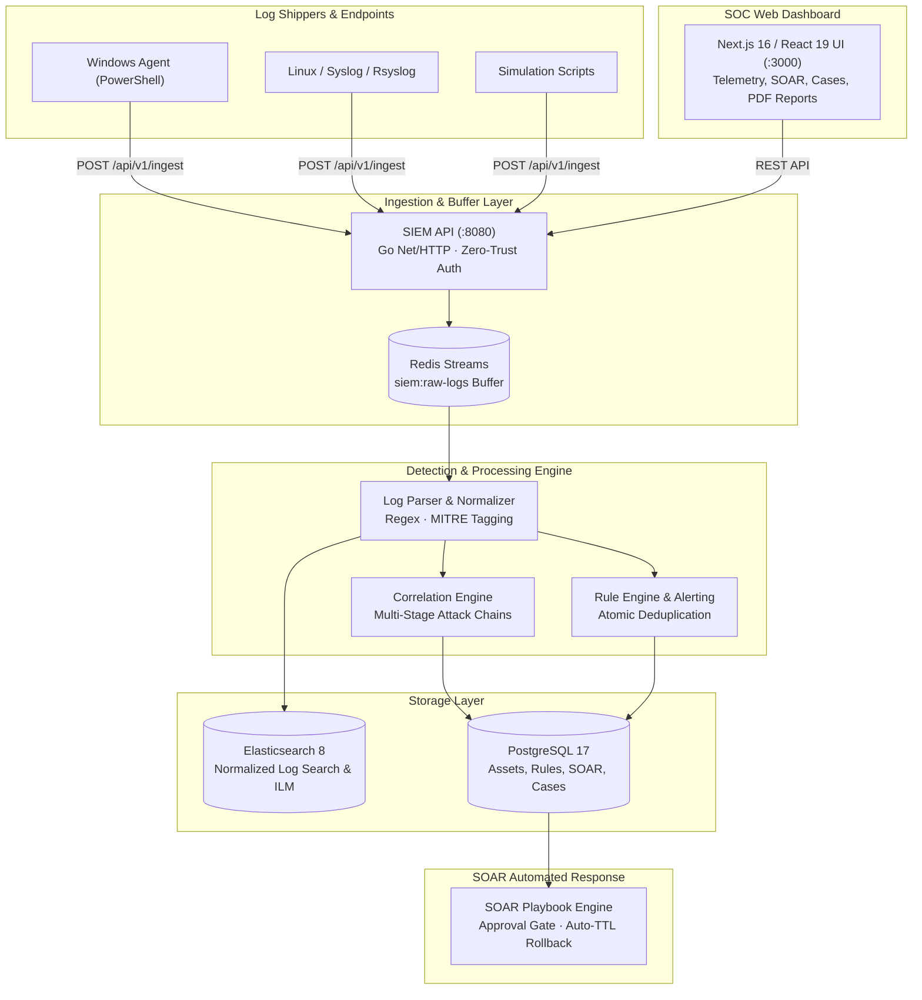

# Sentinel: Mini-SIEM & SOAR Platform

Hệ thống giám sát an toàn thông tin (SIEM) kết hợp phản ứng sự cố tự động (SOAR) dạng micro-architecture hiệu năng cao, xây dựng bằng **Golang**, **Next.js**, **Redis Streams**, **Elasticsearch**, và **PostgreSQL**.

---

## 🏛️ Kiến Trúc Hệ Thống



---

## 🚀 Công Nghệ Sử Dụng

* **Backend**: Go (Golang 1.26), Native Concurrency, HTTP Routing, Zero external HTTP framework.
* **Frontend**: Next.js 16 (App Router), React 19, Tailwind CSS v4, SVG Canvas Telemetry.
* **Log Ingest Buffer**: Redis 7 (Redis Streams, Memory Cap, Backpressure protection).
* **Storage & Search**: Elasticsearch 8 (Daily Index Partitioning, Best Compression, ILM Retention).
* **Relational DB**: PostgreSQL 17 (Advisory Locks, Atomic Receipts, RBAC, SOAR State).
* **Containerization**: Docker Compose; VPS production khuyến nghị RAM tối thiểu 4 GB, SSD 40 GB trở lên.

---

## ⚡ Hướng Dẫn Cài Đặt & Khởi Chạy

### 1. Yêu cầu hệ thống
* Đã cài đặt **Docker** và **Docker Compose**.
* Môi trường develop: khuyến nghị **4 GB RAM**; production preflight chặn dưới 3 GiB, khuyến nghị 4–8 GiB RAM.

### 2. Khởi động toàn bộ hệ thống
```bash
docker compose up -d
```

Sau khoảng 20-30 giây, kiểm tra trạng thái hoạt động:
```bash
curl http://localhost:8080/healthz
```
Hệ thống trả về HTTP 200 `{"status":"healthy"}` cho toàn bộ 6 subsystem.

### 3. Đăng nhập Web Dashboard
* **Địa chỉ Web UI**: [http://localhost:3000](http://localhost:3000)
* **Tài khoản SOC Admin mặc định khi develop**:
  * Email: `admin@example.com`
  * Mật khẩu: `change-me-now` (giá trị mặc định trong Docker Compose; phải thay trước khi triển khai)
* **Tài khoản Analyst**:
  * Email: `analyst@example.com`
  * Mật khẩu: `analyst`

---

## Triển khai VPS với Caddy HTTPS và kiểm tra sau deploy

Xem hướng dẫn theo từng bước tại **[ops/DEPLOY_VPS.md](ops/DEPLOY_VPS.md)**. Cấu hình này dành cho một VPS Linux; tất cả port PostgreSQL, Redis, Elasticsearch, API và frontend giữ loopback, chỉ Caddy mở cổng 80/443.

1. Trỏ DNS `siem.example.org` đến IP VPS, mở firewall 80/443 và SSH cho IP quản trị.
2. `cp .env.production.example .env.production && chmod 600 .env.production`
3. Điền `SIEM_DOMAIN=siem.example.org`, `ACME_EMAIL`, `NEXT_PUBLIC_API_URL=https://siem.example.org` (**không thêm `/api`**), cùng ba secret ngẫu nhiên mạnh.
4. Chạy `node scripts/vps-release.mjs --env .env.production` để xem dry-run.
5. Khi hạ tầng đã sẵn sàng, chạy `node scripts/vps-release.mjs --env .env.production --apply` để kiểm tra preflight, Caddy, khởi động Compose và thử smoke qua HTTPS.
6. Sao lưu: `node scripts/vps-backup.mjs --env .env.production --apply`. Script xuất PostgreSQL dump và repository snapshot Elasticsearch, cần sao chép backup ra ngoài VPS và thử restore riêng.

**Không triển khai tự động chỉ bằng push/PR.** Cần một người vận hành thực hiện lệnh `--apply` trên đúng VPS. Các script không gọi `down -v`, không xóa named volume. `ingest` chỉ là công cụ CLI đọc stdin nên được tách vào profile `manual-tools`, không chạy nền hay restart liên tục.

Thông tin `NEXT_PUBLIC_API_URL` bị đóng gói vào frontend khi build; khi đổi hostname phải build lại frontend. `POSTGRES_PASSWORD` phải là ký tự URL-safe vì Docker Compose hiện nhúng trực tiếp vào PostgreSQL DSN. Không nên thay mật khẩu PostgreSQL trong env sau khi đã tạo volume mà không đổi credential thực tế trong database.

---

## 🛡️ Kịch Bản Mô Phỏng Tấn Công & SOAR 1-Click

Hệ thống tích hợp sẵn kịch bản mô phỏng chuỗi tấn công APT đa tầng (MITRE ATT&CK: **T1110** Brute Force SSH $\rightarrow$ **T1078** Valid Account $\rightarrow$ **T1548.003** Sudo Privilege Escalation):

### Chạy trên Windows:
```powershell
powershell -ExecutionPolicy Bypass -File .\scripts\simulate-attack.ps1
```

### Chạy trên Linux / macOS:
```bash
chmod +x ./scripts/simulate-attack.sh
./scripts/simulate-attack.sh
```

**Quy trình phản ứng sau khi chạy:**
1. Correlation Engine phát hiện chuỗi tấn công và tạo Critical Alert.
2. SOAR Engine tự động kích hoạt Playbook ngăn chặn và gửi yêu cầu phê duyệt.
3. Mở [http://localhost:3000/soar](http://localhost:3000/soar) để bấm **"Phê duyệt Chặn"** IP kẻ tấn công.
4. Kẻ tấn công bị cô lập với thời hạn tự động hoàn tác (TTL) sau 1 giờ.
5. Mở [http://localhost:3000/cases](http://localhost:3000/cases) để xuất **Báo Cáo Incident PDF** chính thức.

---

## 💻 Biến Máy Trạm Thành Log Agent

Để đẩy log bảo mật thực tế từ máy tính lên SIEM:
```powershell
powershell -ExecutionPolicy Bypass -File .\scripts\sentinel-windows-agent.ps1
```
* Kiểm tra danh sách Agent trực tiếp tại [http://localhost:3000/assets](http://localhost:3000/assets).
* Tìm kiếm log thời gian thực tại [http://localhost:3000/events](http://localhost:3000/events).


## Chẩn đoán hệ thống và trạng thái dịch vụ (SOC Admin)

Ở thanh điều hướng tài khoản Admin, mở `/system`. Trang tổng hợp trạng thái theo thời gian thực từ các bộ kiểm tra hiện có: PostgreSQL, Redis, Elasticsearch, database schema, ingest/retry queues và parser connectors. Màn hình hiển thị trạng thái healthy/degraded/unhealthy, thời gian kiểm tra, độ trễ và các chỉ số kết quả; tự tải lại sau 15 giây khi tab đang mở và có nút kiểm tra thủ công.

### Phân quyền và endpoint

- **Public:** `GET /healthz` và `/healthz/{redis,queue,ingest,parser,elasticsearch}` chỉ trả trạng thái (+ uptime ở /healthz), không công khai chuỗi kết nối, lỗi chi tiết hay tên bảng. /healthz trả HTTP 503 nếu có subsystem unhealthy, 200 khi healthy/degraded, tương thích Docker healthcheck hiện tại.
- **Admin:** `GET /api/v1/system/health` trả một snapshot đầy đủ có `services`, `checked_at`, `uptime`, `response_time_ms` và các `checks`, luôn trả HTTP 200 khi đã xác thực, kể cả trạng thái unhealthy, để dashboard đọc được lỗi. Viewer/Analyst không có quyền. Token phải nằm trong HTTP Authorization: Bearer header, không chấp nhận query string token.
- **Admin:** `GET /metrics` nay cần Bearer token Admin. Đây là thay đổi bảo mật có chủ đích: cấu hình hệ thống scrape metrics phải dùng thông tin xác thực hoặc cho phép giám sát qua hạ tầng nội bộ được bảo vệ. Không mở cổng metrics công khai; endpoint không cho cache và không chấp nhận JWT qua query string.
- Backend chỉ chạy `CheckAll` một lần cho mỗi request health tổng quan, tránh kiểm tra lặp và ghi trạng thái cảnh báo hai lần.
- Giữ `healthz` là health check tổng quát; endpoint này không thay thế `/api/v1/system/health` khi cần điều tra sự cố.

### Kiểm tra vận hành

1. Sau khi triển khai, xem `/healthz` và xác nhận không có trường `services`/`checks` trong phản hồi không xác thực.
2. Đăng nhập Admin, mở `/system` và xác nhận từng thành phần trả trạng thái và độ trễ thực.
3. Dùng token Viewer truy cập `/api/v1/system/health` và `/metrics`: phải nhận 403. Khi không token: 401.
4. Thử tạm ngắt một dependency trên **môi trường staging** để xác nhận /healthz trả 503 và admin dashboard vẫn hiển thị thông tin chẩn đoán. Không thực hiện phép thử gây gián đoạn trên production.

## Incident report không truyền token trên URL

Từ trang `/cases`, nút **Tải báo cáo Incident** giờ gọi API bằng `Authorization: Bearer` rồi tải tệp HTML đã tạo. Mở tệp HTML bằng trình duyệt để **Print / Save as PDF**. Backend hiện xuất HTML để in PDF hoặc JSON, không tạo PDF nhị phân trực tiếp; giao diện được ghi rõ định dạng.

Tất cả endpoint cần JWT không còn chấp nhận `?token=...`; token trong query có thể bị lưu vào lịch sử browser, log proxy và hệ thống phân tích. Mọi client/agent quản trị phải dùng header Authorization. API key ingest vẫn giữ cơ chế Bearer API key riêng. Đây là thay đổi tương thích API có chủ đích trước khi public dịch vụ lên VPS.

Các giá trị động của báo cáo HTML (bao gồm severity, action type, status và CSS class priority) đã được escape để tránh chèn thẻ HTML khi dữ liệu case bị nhiễm ký tự không tin cậy.

## Tối ưu bộ health check trên VPS

- Sáu thành phần PostgreSQL, Redis, Elasticsearch, database schema, hàng đợi và connectors được kiểm tra **đồng thời** dưới cùng request context. Thời gian trả phản hồi phụ thuộc nhiều hơn vào service chậm nhất thay vì cộng dồn độ trễ sáu service. Không thêm cache hoặc thay đổi API health.
- Redis sử dụng khóa thử đọc/ghi **riêng cho từng request**, TTL 10 giây và dọn dẹp có timeout, tránh race giữa nhiều lần kiểm tra /healthz hoặc /system.
- Kiểm tra consumer group dùng một lượt XINFO GROUPS thay vì hai, đồng thời hiển thị đúng số consumer của parser thay vì lấy group đầu tiên bất kỳ.
- Kiểm thử race trong CI gồm nhiều health probe Redis đồng thời và xác nhận CheckAll chạy đồng thời nhưng vẫn tổng hợp kết quả an toàn.

## Giảm round-trip PostgreSQL trong health check

Với mỗi lần kiểm tra hệ thống, CheckPostgres nay kết hợp xác thực truy vấn SQL và đếm bảng bằng **một query** thay vì SELECT version() rồi đếm bảng. CheckDatabase đọc danh sách năm bảng thiết yếu bằng **một query** thay vì năm lần SELECT EXISTS riêng biệt.

Tổng số query PostgreSQL dùng cho hai nhóm kiểm tra này trên đường khỏe mạnh giảm từ **8 xuống 3** mỗi lượt tổng hợp (không tính phần hàng đợi/alert chỉ chạy khi cần). Status healthy/degraded/unhealthy, danh sách bảng thiếu, và cấu trúc JSON của endpoint được giữ nguyên.

Thay đổi giúp giảm network round-trip khi backend và PostgreSQL ở node khác hoặc VPS chịu tải. Không thay đổi schema, index, migration hoặc quyền truy cập; độ trễ thực tế cần đo trên VPS.
