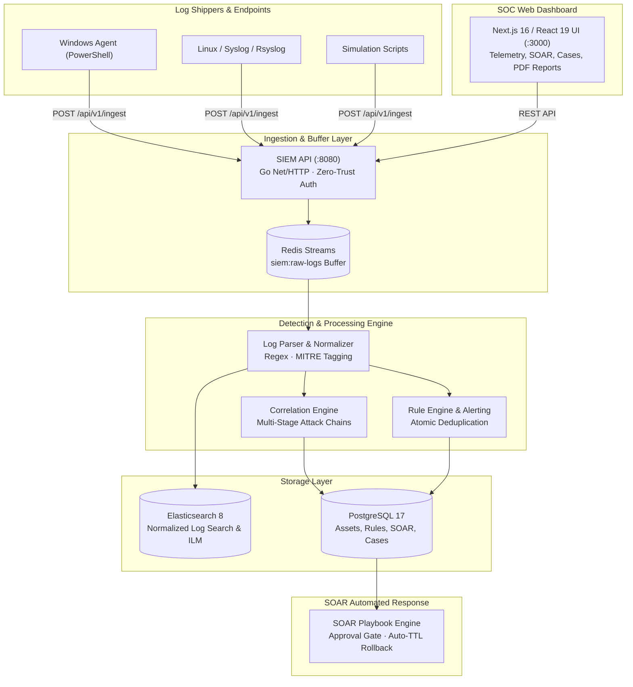

# Sentinel: Mini-SIEM & SOAR Platform

Hệ thống giám sát an toàn thông tin (SIEM) kết hợp phản ứng sự cố tự động (SOAR) dạng micro-architecture hiệu năng cao, xây dựng bằng **Golang**, **Next.js**, **Redis Streams**, **Elasticsearch**, và **PostgreSQL**.

---

## 🏛️ Kiến Trúc Hệ Thống



---

## 🚀 Công Nghệ Sử Dụng

* **Backend**: Go (Golang 1.26), Native Concurrency, HTTP Routing, Zero external HTTP framework.
* **Frontend**: Next.js 16 (App Router), React 19, Tailwind CSS v4, SVG Canvas Telemetry.
* **Log Ingest Buffer**: Redis 7 (Redis Streams, Memory Cap, Backpressure protection).
* **Storage & Search**: Elasticsearch 8 (Daily Index Partitioning, Best Compression, ILM Retention).
* **Relational DB**: PostgreSQL 17 (Advisory Locks, Atomic Receipts, RBAC, SOAR State).
* **Containerization**: Docker Compose (Tối ưu hóa tổng RAM toàn bộ hệ thống < 1GB).

---

## ⚡ Hướng Dẫn Cài Đặt & Khởi Chạy

### 1. Yêu cầu hệ thống
* Đã cài đặt **Docker** và **Docker Compose**.
* RAM tối thiểu: **2 GB** (Khuyến nghị 4 GB).

### 2. Khởi động toàn bộ hệ thống
```bash
docker compose up -d
```

Sau khoảng 20-30 giây, kiểm tra trạng thái hoạt động:
```bash
curl http://localhost:8080/healthz
```
Hệ thống trả về HTTP 200 `{"status":"healthy"}` cho toàn bộ 6 subsystem.

### 3. Đăng nhập Web Dashboard
* **Địa chỉ Web UI**: [http://localhost:3000](http://localhost:3000)
* **Tài khoản SOC Admin mặc định khi develop**:
  * Email: `admin@example.com`
  * Mật khẩu: `change-me-now` (giá trị mặc định trong Docker Compose; phải thay trước khi triển khai)
* **Tài khoản Analyst**:
  * Email: `analyst@example.com`
  * Mật khẩu: `analyst`

---

## Triển khai VPS an toàn (production readiness)

Các container PostgreSQL, Redis, Elasticsearch, Backend, Frontend, Beats và Fleet mặc định **chỉ bind 127.0.0.1 trên host**. Điều này ngăn vô tình mở cổng DB và API trực tiếp ra Internet. Truy cập từ thiết bị bên ngoài cần một reverse proxy HTTPS, DNS và firewall được cấu hình đúng.

1. Sao chép file mẫu: cp .env.production.example .env.production
2. Tạo POSTGRES_PASSWORD và ADMIN_PASSWORD khác nhau, tối thiểu 16 ký tự, và JWT_SECRET dài tối thiểu 32 ký tự; không dùng mật khẩu mặc định hay commit secret lên Git.
3. Đặt NEXT_PUBLIC_API_URL thành URL HTTPS của reverse proxy (ví dụ https://siem.example.org/api). Cấu hình proxy chuyển tiếp tới localhost:8080; web tới localhost:3000. Thiết lập TLS, CORS và firewall trên VPS. Biến NEXT_PUBLIC_API_URL được đóng gói lúc build Next.js; sau khi đổi URL phải chạy docker compose --env-file .env.production up -d --build frontend để build lại.
4. Chạy kiểm tra trước khi khởi động: node scripts/production-preflight.mjs --env .env.production
5. Khởi động: docker compose --env-file .env.production up -d --build
6. Kiểm tra: docker compose ps; curl http://127.0.0.1:8080/healthz; xác nhận từ Internet chỉ cổng 443 của proxy được truy cập.

Preflight kiểm tra chế độ production, mật khẩu/secret, HTTPS API URL, bind host các dịch vụ dữ liệu, RAM (tối thiểu 3 GiB) và dung lượng trống (tối thiểu 8 GiB). Secret không được in ra log. Đây là **bước kiểm tra trước triển khai**, không tự cài SSL, tạo domain, sửa firewall, cài Redis/Elasticsearch hay thay thế kiểm thử tải, khôi phục dữ liệu.

Không sử dụng các tài khoản hoặc mật khẩu dev mặc định trên hệ thống có Internet. Theo dõi dung lượng index và xây dựng chính sách backup/restore trước khi lưu log thật.

---

## 🛡️ Kịch Bản Mô Phỏng Tấn Công & SOAR 1-Click

Hệ thống tích hợp sẵn kịch bản mô phỏng chuỗi tấn công APT đa tầng (MITRE ATT&CK: **T1110** Brute Force SSH $\rightarrow$ **T1078** Valid Account $\rightarrow$ **T1548.003** Sudo Privilege Escalation):

### Chạy trên Windows:
```powershell
powershell -ExecutionPolicy Bypass -File .\scripts\simulate-attack.ps1
```

### Chạy trên Linux / macOS:
```bash
chmod +x ./scripts/simulate-attack.sh
./scripts/simulate-attack.sh
```

**Quy trình phản ứng sau khi chạy:**
1. Correlation Engine phát hiện chuỗi tấn công và tạo Critical Alert.
2. SOAR Engine tự động kích hoạt Playbook ngăn chặn và gửi yêu cầu phê duyệt.
3. Mở [http://localhost:3000/soar](http://localhost:3000/soar) để bấm **"Phê duyệt Chặn"** IP kẻ tấn công.
4. Kẻ tấn công bị cô lập với thời hạn tự động hoàn tác (TTL) sau 1 giờ.
5. Mở [http://localhost:3000/cases](http://localhost:3000/cases) để xuất **Báo Cáo Incident PDF** chính thức.

---

## 💻 Biến Máy Trạm Thành Log Agent

Để đẩy log bảo mật thực tế từ máy tính lên SIEM:
```powershell
powershell -ExecutionPolicy Bypass -File .\scripts\sentinel-windows-agent.ps1
```
* Kiểm tra danh sách Agent trực tiếp tại [http://localhost:3000/assets](http://localhost:3000/assets).
* Tìm kiếm log thời gian thực tại [http://localhost:3000/events](http://localhost:3000/events).


## Chẩn đoán hệ thống và trạng thái dịch vụ (SOC Admin)

Ở thanh điều hướng tài khoản Admin, mở `/system`. Trang tổng hợp trạng thái theo thời gian thực từ các bộ kiểm tra hiện có: PostgreSQL, Redis, Elasticsearch, database schema, ingest/retry queues và parser connectors. Màn hình hiển thị trạng thái healthy/degraded/unhealthy, thời gian kiểm tra, độ trễ và các chỉ số kết quả; tự tải lại sau 15 giây khi tab đang mở và có nút kiểm tra thủ công.

### Phân quyền và endpoint

- **Public:** `GET /healthz` và `/healthz/{redis,queue,ingest,parser,elasticsearch}` chỉ trả trạng thái (+ uptime ở /healthz), không công khai chuỗi kết nối, lỗi chi tiết hay tên bảng. /healthz trả HTTP 503 nếu có subsystem unhealthy, 200 khi healthy/degraded, tương thích Docker healthcheck hiện tại.
- **Admin:** `GET /api/v1/system/health` trả một snapshot đầy đủ có `services`, `checked_at`, `uptime`, `response_time_ms` và các `checks`, luôn trả HTTP 200 khi đã xác thực, kể cả trạng thái unhealthy, để dashboard đọc được lỗi. Viewer/Analyst không có quyền.
- **Admin:** `GET /metrics` nay cần Bearer token Admin. Đây là thay đổi bảo mật có chủ đích: cấu hình hệ thống scrape metrics phải dùng thông tin xác thực hoặc cho phép giám sát qua hạ tầng nội bộ được bảo vệ. Không mở cổng metrics công khai.
- Backend chỉ chạy `CheckAll` một lần cho mỗi request health tổng quan, tránh kiểm tra lặp và ghi trạng thái cảnh báo hai lần.
- Giữ `healthz` là health check tổng quát; endpoint này không thay thế `/api/v1/system/health` khi cần điều tra sự cố.

### Kiểm tra vận hành

1. Sau khi triển khai, xem `/healthz` và xác nhận không có trường `services`/`checks` trong phản hồi không xác thực.
2. Đăng nhập Admin, mở `/system` và xác nhận từng thành phần trả trạng thái và độ trễ thực.
3. Dùng token Viewer truy cập `/api/v1/system/health` và `/metrics`: phải nhận 403. Khi không token: 401.
4. Thử tạm ngắt một dependency trên **môi trường staging** để xác nhận /healthz trả 503 và admin dashboard vẫn hiển thị thông tin chẩn đoán. Không thực hiện phép thử gây gián đoạn trên production.
